# Infraestructura AAA con RADIUS (NPS) - Router R1 y Switch SW1

## Video demostrativo

[Ver video en YouTube](ENLACE_DEL_VIDEO)

Grabado con hora y fecha visibles, cara y voz del autor.

## Propósito del laboratorio

Implementar autenticación, autorización y contabilidad (AAA) centralizadas con RADIUS en un router y un switch Cisco, usando Network Policy Server (NPS) sobre Active Directory. Cada usuario del dominio se autentica contra NPS y recibe un nivel de privilegio según su grupo (Nivel 0, Nivel 5 o Nivel 10). Además se configura un usuario local como respaldo, SSH como acceso remoto y el registro de eventos de autenticación, autorización y RADIUS.

## Topología

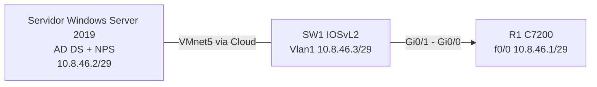

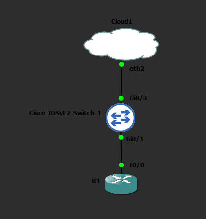

## Plan de direccionamiento

Base 10.8.46.0 (matrícula 20250846), red de gestión /29.

| Equipo | Interfaz | IP | Función |
|---|---|---|---|
| Servidor (WIN-6C0C5K9EGDF) | Ethernet0 | 10.8.46.2/29 | AD DS y NPS (RADIUS) |
| R1 | FastEthernet0/0 | 10.8.46.1/29 | Cliente RADIUS, SSH, consola/aux con AAA |
| SW1 | Vlan1 | 10.8.46.3/29 | Cliente RADIUS, SSH, consola/aux con AAA |

El servidor usa además un adaptador NAT (VMnet8) solo para salida a Internet; no forma parte de la gestión.

## Active Directory

Dominio `nivel.local` (NetBIOS NIVEL) en el servidor.

| Grupo | Usuario | Nivel |
|---|---|---|
| Nivel 0 | user0 | 0 |
| Nivel 5 | user5 | 5 |
| Nivel 10 | user10 | 10 |

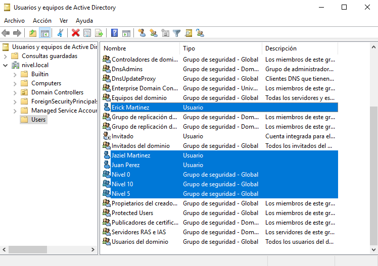

## NPS (servidor RADIUS)

### Clientes RADIUS

| Nombre | IP | Estado |
|---|---|---|
| R1 | 10.8.46.1 | Habilitada |
| SW1 | 10.8.46.3 | Habilitada |

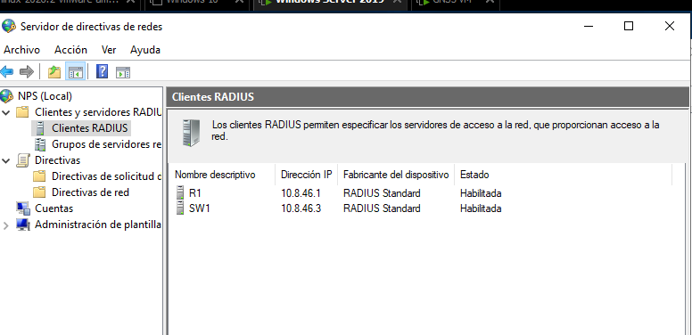

### Directivas de red

Una directiva por grupo, con condición "Grupos de Windows", permiso "Conceder acceso", método PAP y el atributo Cisco-AV-Pair con el nivel correspondiente (`shell:priv-lvl=N`), además de Service-Type `Login`.

| Directiva | Condición | Atributo Cisco-AV-Pair |
|---|---|---|
| NIVEL 0 | Grupo Nivel 0 | shell:priv-lvl=0 |
| NIVEL 5 | Grupo Nivel 5 | shell:priv-lvl=5 |
| NIVEL 10 | Grupo Nivel 10 | shell:priv-lvl=10 |

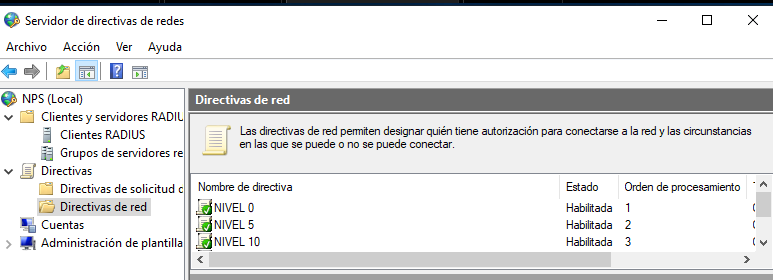

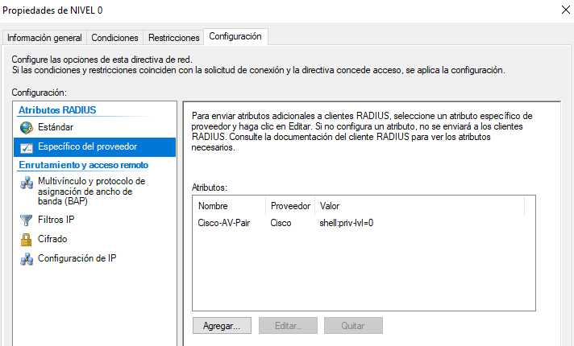

### Evidencia de acceso concedido (evento 6272)

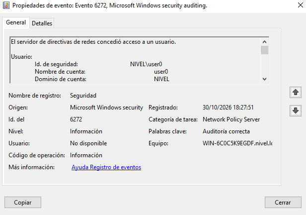

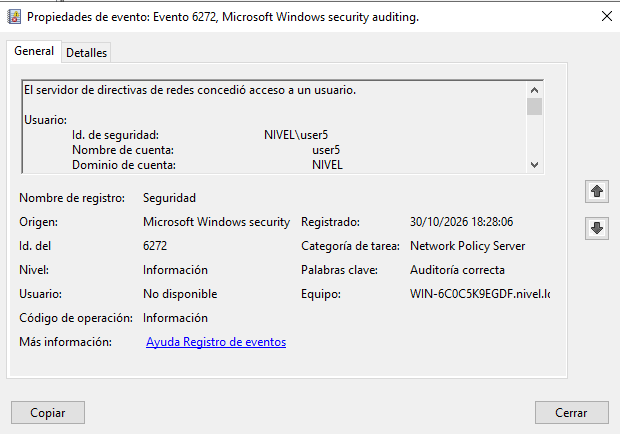

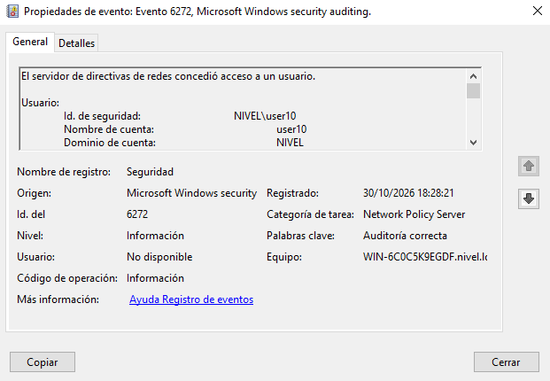

### Evidencia de rechazo (evento 6273)

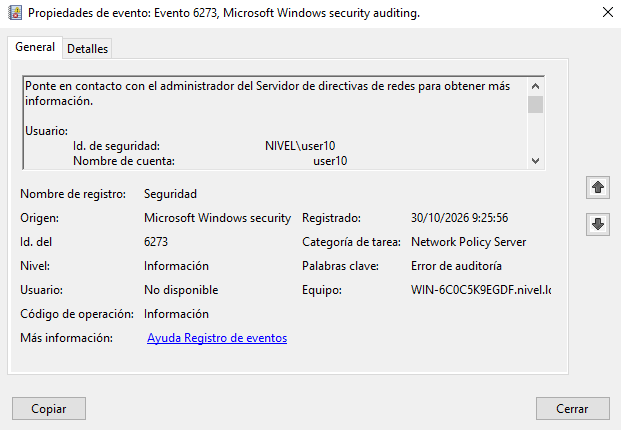

## Configuración de R1

Configuración completa en [`configs/R1_running.txt`](configs/R1_running.txt) y comandos aplicados en [`scripts/R1_config.txt`](scripts/R1_config.txt).

Puntos principales:
- `aaa new-model`, RADIUS (`radius server NPS`, 10.8.46.2) y grupo `NPS_GRP`.
- `aaa authentication login` y `aaa authorization exec` contra NPS con respaldo `local`.
- `aaa accounting exec` y `aaa accounting network` hacia NPS.
- Consola y auxiliar con autenticación y autorización AAA; `line vty` solo con SSH.
- Usuario local `admin` con privilegio 15 como respaldo.
- SSH versión 2 y `logging buffered`.

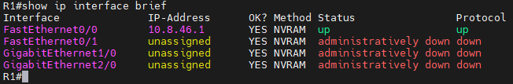

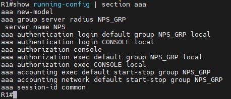

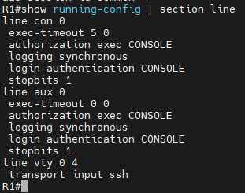

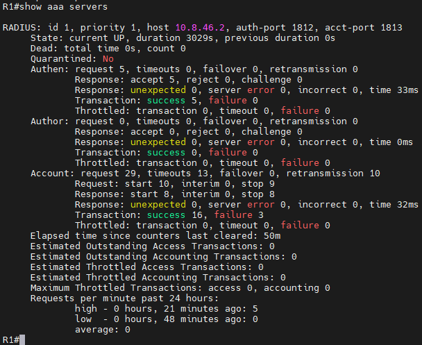

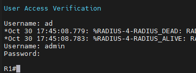

Startup configuration: [`configs/R1_startup.txt`](configs/R1_startup.txt) y running configuration: [`configs/R1_running.txt`](configs/R1_running.txt).

## Configuración de SW1

Configuración completa en [`configs/SW1_running.txt`](configs/SW1_running.txt) y comandos aplicados en [`scripts/SW1_config.txt`](scripts/SW1_config.txt).

Puntos principales:
- Hostname SW1, interfaces de acceso en VLAN 1 y Vlan1 con 10.8.46.3/29.
- `aaa new-model`, RADIUS (10.8.46.2) y grupo `NPS_GRP`, con autenticación y autorización EXEC contra NPS y respaldo `local`.
- `aaa authorization console` y accounting exec/network hacia NPS.
- Usuario local `admin` privilege 15, `enable secret`, SSH versión 2 y `login local` como respaldo en consola, aux y vty.

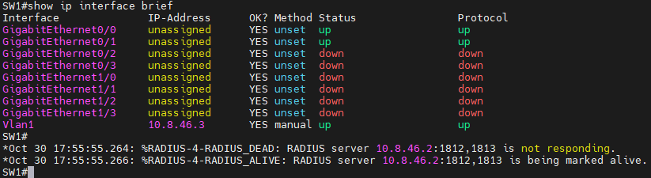

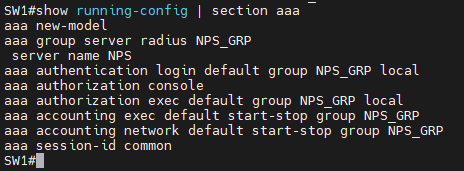

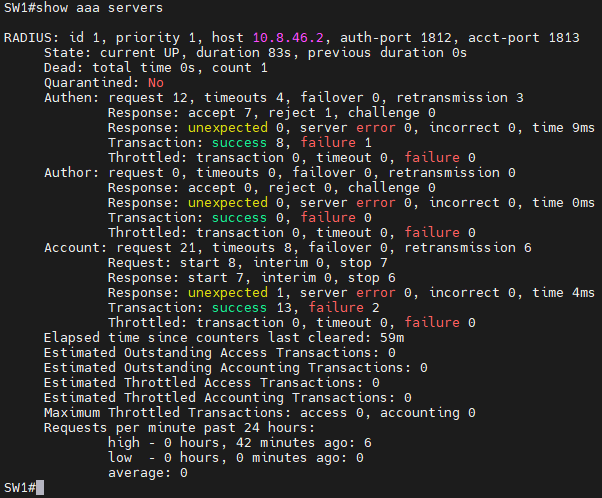

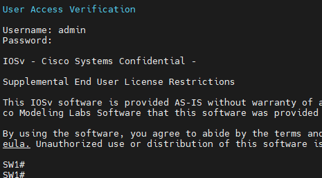

Startup configuration de SW1 también disponible en [`configs/SW1_startup.txt`](configs/SW1_startup.txt).

## Pruebas de autorización por nivel (SSH)

Las pruebas se hicieron por SSH desde el servidor, con el comando `show privilege` para comprobar el nivel asignado por NPS.

| Usuario | Grupo | Equipo | Nivel esperado | Captura |
|---|---|---|---|---|
| user0 | Nivel 0 | R1 | 0 | 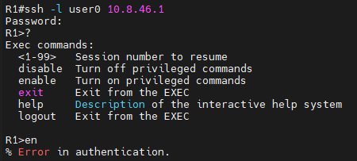 |
| user5 | Nivel 5 | R1 | 5 | 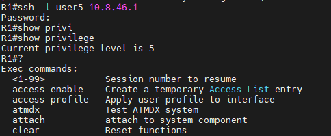 |
| user10 | Nivel 10 | R1 | 10 | 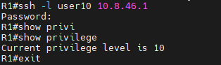 |
| user0 | Nivel 0 | SW1 | 0 | 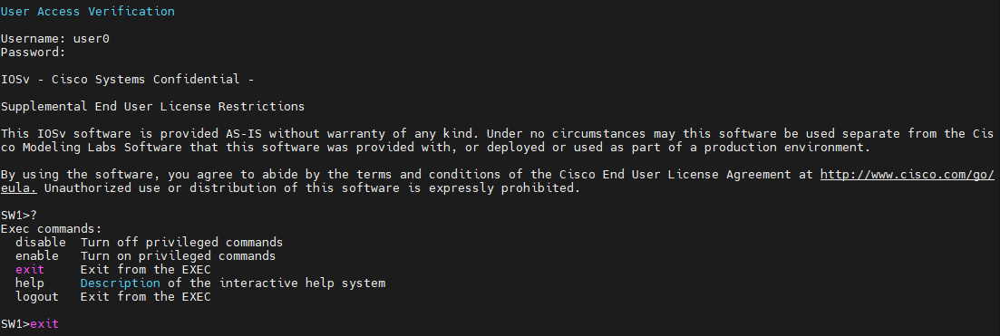 |
| user5 | Nivel 5 | SW1 | 5 | 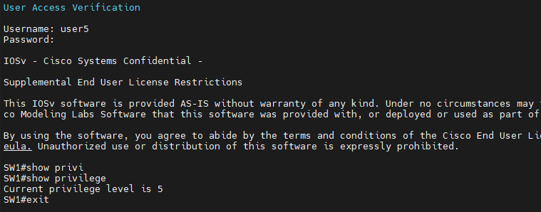 |
| user10 | Nivel 10 | SW1 | 10 | 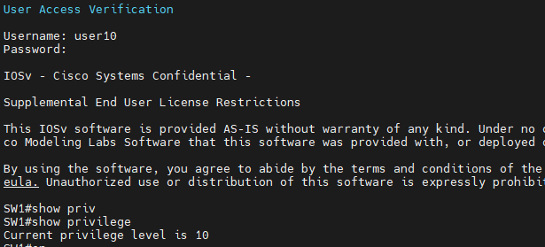 |

Nota: en nivel 0 algunos comandos como `show privilege` pueden ser rechazados; ese rechazo es la evidencia de que el nivel 0 restringe los comandos.

## Logs y registros

- Accounting de sesiones EXEC y de red hacia NPS en R1 y SW1 (`aaa accounting exec` y `aaa accounting network`).
- Contadores RADIUS en `show aaa servers` (ver capturas 13 y 16).
- Eventos de NPS 6272 (acceso concedido) y 6273 (denegado) en el Visor de eventos.
- Buffer de logs local en R1 (`logging buffered`).

## Scripts

- [`scripts/R1_config.txt`](scripts/R1_config.txt): comandos aplicados en R1.
- [`scripts/SW1_config.txt`](scripts/SW1_config.txt): comandos aplicados en SW1.

## Running-configs

- [`configs/R1_running.txt`](configs/R1_running.txt)
- [`configs/R1_startup.txt`](configs/R1_startup.txt)
- [`configs/SW1_running.txt`](configs/SW1_running.txt)
- [`configs/SW1_startup.txt`](configs/SW1_startup.txt)
- [`configs/aaa_servers_R1_SW1.txt`](configs/aaa_servers_R1_SW1.txt): salida de `show aaa servers`.
